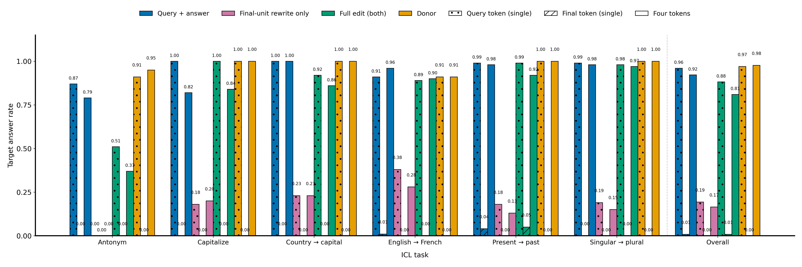
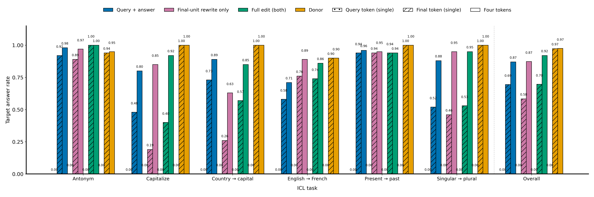

# Raw-text ICL NLA edits at layers 24 and 40

Both layers use custom EasyNLA pairs trained with the same recipe. The layer-32 figure uses the official released pair, so differences with that figure can reflect both layer and NLA training. Each layer has six tasks, 10 items per task, and 10 seeds per item. The three edits and donor are evaluated at the query token, final token, and last four tokens; all prompts are raw text without a chat template.

## Layer 24

At layer 24, query-and-answer substitutions redirect answers reliably when patched at the query token, reaching 0.960, close to donor patching (0.970). Adding the final-unit rewrite reduces the target rate to 0.882, while the rewrite alone reaches 0.193. Four-token patching shows the same ordering: substitutions reach 0.922, combined edits 0.810, and the rewrite alone 0.165. Patching the final token is nearly ineffective, with combined edits reaching 0.008. Thus, NLA edits can redirect the answer at the early query position, and the standardized prediction clause lowers aggregate performance at this layer.

## Layer 40

At layer 40, NLA edits redirect answers at the end of the prompt, while query-token patching produces no target answers. At the final token, substitutions, final-unit rewrites, and combined edits reach 0.695, 0.583, 0.697, respectively, compared with 0.973 for donor patching. Four-token patching raises these rates to 0.870, 0.873, 0.920, with combined edits approaching the donor rate of 0.975. Capitalize remains weak under single-token combined edits (0.40) despite successful donor patching (1.00), and improves to 0.92 with four-token edits. At this layer, patching multiple positions improves NLA redirection even though the final token alone is sufficient for the donor.

## Controls

The unpatched model gives the base answer in 0.985 of trials. Round-trip target rates are zero at both layers and all three evaluated spans. No-op target rates are zero except for 1 of 600 four-token trials at layer 24 (0.0017). Round-trip base-answer retention ranges from 0.942 to 0.978 at layer 24 and from 0.940 to 0.983 at layer 40.
